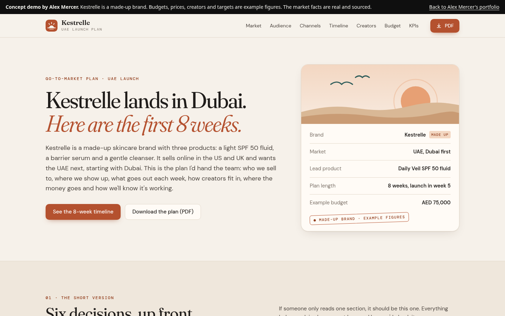

# Kestrelle: UAE launch plan

A sample marketing launch plan for a made-up skincare brand opening in the UAE, starting with Dubai. It covers positioning and audience, a market snapshot built only from public sources, a channel plan, an 8-week timeline, a launch-week content calendar, creator outreach (with a sample first message), an example budget split, KPIs with a test plan, and the main risks.

This is a concept demo. Kestrelle, its products, prices, creators, budget and targets are all made up. The market facts (population, internet and social media figures, cosmetics registration rules, the influencer permit, expected Ramadan dates) are real and linked to their sources on the page. It is not client work and nothing in it has run.

## View it

Live page: https://alexmercerprojects.com/kestrelle-launch-plan/

Or open `docs/index.html` in a browser. The same plan as a 10-page A4 PDF is in `docs/Kestrelle-launch-plan-DEMO.pdf`.



## What's in it

- The short version: six decisions up front
- Market snapshot with sourced figures, what they mean for the plan, and a separate box of assumptions to check
- Positioning statement, three audience sketches, message pillars and words to avoid
- Channel plan: one job per channel and what to watch
- 8-week timeline with the launch in week 5 and the expected Ramadan window marked
- Launch-week content calendar, day by day
- Creator tiers, the outreach process, a sample first message and the brief checklist
- Example budget of AED 75,000 with a split and pacing
- KPIs with example targets, three tests with clear rules for calling them
- Risks and the plan B for each

## Screenshots

- [Desktop](screenshots/desktop.png)
- [Phone](screenshots/mobile.png)
- [Timeline](screenshots/timeline.png)
- [Budget](screenshots/budget.png)

## How it's built

Plain HTML and CSS with a few lines of vanilla JavaScript in `docs/`. The charts are hand-written SVG and CSS grid, so there are no chart libraries and no outside requests. A print stylesheet lays the page out as an A4 document.

```
(cd docs && python3 -m http.server 8765)
./tools/make-pdf.sh     # PDF with headless Chrome
./tools/shoot.sh http://localhost:8765/ screenshots
```

Fonts: Fraunces, DM Sans and DM Mono, all under the SIL Open Font License (see `docs/fonts/LICENSE.txt`).

## Contact

[alexmercer.projects@gmail.com](mailto:alexmercer.projects@gmail.com)
